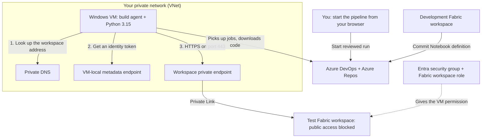

# Fabric CI/CD with Build Agents Inside Your Network

**A beginner-friendly runbook**

**Who this is for**
Engineers who know Azure basics but have never set up Fabric private links or self-hosted build agents

**What you'll build**
An automated pipeline that copies a Fabric Notebook into a test workspace that is locked off from the public internet

**Tools used**
Azure portal, Microsoft Fabric, Azure DevOps (Repos + Pipelines), a Windows VM, Python 3.15

**Last checked against Microsoft docs**
October 18, 2026

> **How to use this runbook:** Work through the phases in order. Each phase ends
> with a **✅ Checkpoint**. Don't move on until the checkpoint passes; most
> problems later on come from a skipped checkpoint.

---

## Contents

- [Part A - Understand what you're building](#part-a---understand-what-youre-building)
- [Part B - Get ready](#part-b---get-ready)
- [Part C - Build it (13 phases)](#part-c---build-it)
- [Part D - When things go wrong](#part-d---when-things-go-wrong)
- [Part E - For later: security, rollback, production](#part-e---for-later)
- [References](#references)

---

## Part A - Understand what you're building

### The problem in one paragraph

Your company wants the **test Fabric workspace** to be unreachable from the
public internet. That's great for security, but it breaks normal CI/CD:
Microsoft-hosted build agents live on the public internet, so they can no longer
reach the workspace. The fix is to run the build agent **on your own virtual
machine, inside your own private network**, and give that network a private
"door" into the workspace.

### An everyday analogy

Think of the test workspace as an office building that has locked its front door.

- The **private endpoint** is a private side entrance that only opens onto your company's car park (your virtual network).
- The **build agent VM** is a delivery van that is parked in that car park, so it can use the side entrance.
- The **managed identity** is the van's staff badge. Getting through the door (network) and being allowed into the rooms (permissions) are **two separate checks**; you need both.

### The picture



**In words:**

1. You build a Notebook in the **development** workspace.
2. Fabric's Git integration saves it into **Azure Repos**.
3. You start the pipeline in **Azure DevOps**.
4. The job runs on **your VM**, inside your private network.
5. The VM gets a sign-in token from Azure, without any password or secret.
6. The VM sends the Notebook through the **private endpoint** into the **test** workspace.

> **Good to know:** Only the VM-to-Fabric connection is private. The VM still
> uses normal, approved internet access to talk to Azure DevOps and download
> updates. That's expected.

### Key terms (glossary)

| Term | Plain-English meaning |
| --- | --- |
| **Workspace** | A folder in Fabric that holds Notebooks, reports, and other items |
| **VNet (virtual network)** | Your company's private network inside Azure |
| **Subnet** | A smaller section of a VNet. You'll use one for the VM and one for the private endpoint |
| **Private endpoint** | A private IP address inside your VNet that connects straight to one Fabric workspace |
| **Private Link** | The Azure technology that makes private endpoints work |
| **Private DNS** | Makes the workspace's web address point to the private IP instead of a public one |
| **Self-hosted agent** | Azure DevOps software installed on *your* machine that runs pipeline jobs |
| **Agent pool** | A named group of agents. Pipelines pick a pool to run on |
| **Managed identity** | An automatic Azure identity attached to the VM. It lets the VM sign in without a stored password |
| **Metadata endpoint (IMDS)** | A special local address (`169.254.169.254`) where the VM asks Azure for its identity token |
| **PAT (personal access token)** | A temporary registration credential; revoke it after registering the agent |
| **Fabric Git format** | How Fabric saves a Notebook into Git: a folder with `.platform` and `notebook-content.py` |
| **F SKU** | A paid Fabric capacity type. Required for workspace private links |

### What this pipeline can and can't do

The deployment script in this runbook is intentionally simple. It's a good
first step, not a full CI/CD framework.

| ✅ It can | ❌ It can't (yet) |
| --- | --- |
| Deploy a standalone Notebook | Deploy other item types (pipelines, lakehouses, reports…) |
| Create a new Notebook or update an existing one | Swap values per environment (`parameter.yml` is rejected) |
| Wait for Fabric to finish and confirm the item exists | Re-link Lakehouses, Environments, or connections |
| Use the Python 3.15 standard library without extra packages | Delete old items, retry automatically, or roll back |

**Two things that will surprise you if you don't know them:**

- Notebooks are matched **by name**. If a Notebook with the same name already exists in the test workspace, it **gets overwritten**.
- **Renaming** a Notebook creates a new item; the old one isn't removed.

### Files that come with this runbook

Keep these in the same folder as this runbook:

| File | What it does |
| --- | --- |
| [azure-pipelines-deploy.yml](./azure-pipelines-deploy.yml) | The pipeline definition |
| [deploy_fabric.py](./deploy_fabric.py) | The Python deployment script |
| [requirements.txt](./requirements.txt) | Comments only: the script uses no extra packages |
| [test_deploy_fabric.py](./test_deploy_fabric.py) | Offline tests for the script |
| [workspace-private-link.json](./workspace-private-link.json) | Azure template that creates the private link resource |


---

## Part B - Get ready

### B1. Line up the right people

You probably won't have every permission yourself. That's normal. Book time with
these people **before** you start.

| Person | What you'll need from them |
| --- | --- |
| **Azure platform / network engineer** | Create the network, VM, private endpoint, and DNS; open firewall rules |
| **VM administrator** | Turn on the VM's managed identity |
| **Windows administrator** | Local admin rights on the VM to install software |
| **Fabric administrator** | Enable the inbound-network, API, and source Git tenant settings for the approved scopes |
| **Fabric workspace admin** | Admin on both the development and test workspaces |
| **Entra (Azure AD) group owner** | Create a security group and add the VM to it |
| **Azure DevOps admin** | Create the agent pool and let you register an agent |

### B2. Fill in your worksheet

Throughout this runbook you'll see placeholders like `REPLACE-WITH-VM-NAME`.
Copy this table somewhere safe and fill it in as you go. **Never paste a
placeholder into a command.**

**Azure**

| Placeholder | Where to find it | Your value |
| --- | --- | --- |
| `REPLACE-WITH-SUBSCRIPTION-ID` | Azure portal > Subscriptions |  |
| `REPLACE-WITH-RESOURCE-GROUP` | The resource group you're allowed to use |  |
| `REPLACE-WITH-REGION` | Region for the VM, VNet, and endpoint |  |
| `REPLACE-WITH-TENANT-ID` | Entra ID > Overview > Tenant ID |  |
| `REPLACE-WITH-VNET` | Your approved VNet |  |
| `REPLACE-WITH-AGENT-SUBNET` | Subnet for the VM |  |
| `REPLACE-WITH-ENDPOINT-SUBNET` | Subnet for the private endpoint |  |
| `REPLACE-WITH-PRIVATE-LINK-NAME` | You choose it in Phase 1 |  |
| `REPLACE-WITH-ENDPOINT-NAME` | You choose it in Phase 1 |  |
| `REPLACE-WITH-PRIVATE-ENDPOINT-IPS` | Recorded at the end of Phase 1 (e.g. `10.0.1.4`) |  |
| `REPLACE-WITH-VM-NAME` | Your VM's name |  |
| `REPLACE-WITH-VM-PRINCIPAL-ID` | Recorded in Phase 5 |  |

**Fabric and Entra**

| Placeholder | Where to find it | Your value |
| --- | --- | --- |
| `REPLACE-WITH-DEV-WORKSPACE` | Name of the development workspace |  |
| `REPLACE-WITH-TEST-WORKSPACE-ID` | Test workspace URL: the ID after `groups/` |  |
| `REPLACE-WITH-GROUP-NAME` | Security group name (e.g. `fabric-automation-test`) |  |
| `REPLACE-WITH-GROUP-ID` | Entra > Groups > your group > Object ID |  |

**Azure DevOps and the VM**

| Placeholder | Where to find it | Your value |
| --- | --- | --- |
| `REPLACE-WITH-ORGANIZATION` | `dev.azure.com/<this part>` |  |
| `REPLACE-WITH-PROJECT` | Your DevOps project |  |
| `REPLACE-WITH-REPOSITORY` | Your Azure Repos repository |  |
| `REPLACE-WITH-BRANCH` | The reviewed branch you'll deploy from |  |
| `REPLACE-WITH-POOL-NAME` | You choose it in Phase 4 (e.g. `fabric-private-pool`) |  |
| `REPLACE-WITH-AGENT-NAME` | You choose it in Phase 4 (e.g. `fabric-agent-001`) |  |
| `REPLACE-WITH-PYTHON-EXE` | Recorded in Phase 6 |  |
| `REPLACE-WITH-LOCAL-REPO` | Folder on the VM where you download the repo |  |

> **Don't mix up these three IDs.** The *workspace ID* identifies the Fabric
> workspace. The *VM principal ID* identifies the VM's identity. The *group ID*
> identifies the security group. They all look like long UUIDs.

### B3. Check Fabric is compatible

Ask your Fabric administrator to confirm each item. If any answer is "no",
**stop here** and sort it out first.

- [ ] The test workspace uses an **F SKU** capacity. Trial and P SKU capacities don't support workspace private links. [1]
- [ ] The tenant setting **Configure workspace-level inbound network rules** is turned on. [1]
- [ ] The test workspace contains **no Power BI semantic models**. Their presence blocks private links. [2]
- [ ] The test workspace is **not** assigned to a **Fabric deployment pipeline**. [2]
- [ ] The tenant setting **Users can synchronize workspace items with their Git repositories** is on for whoever builds the Notebook. [10]

> **Don't confuse the two kinds of "pipeline".** *Fabric deployment pipelines*
> (built into Fabric) don't work with private links. *Azure DevOps pipelines*
> (what this runbook uses) work fine.

---

## Part C - Build it

Each phase follows the same pattern:

- **Why** - what you're doing and why it matters
- **Who / where** - which person and which tool
- **Steps** - what to click or type
- **✅ Checkpoint** - how to know it worked

---

### Phase 1 - Create the private "door" into the workspace

**Why:** This creates the private endpoint: a private IP address in your network
that leads straight to the test workspace.

**Who / where:** Azure platform engineer, in the Azure portal.

**Step 1a - Get your IDs**

1. Open the test workspace in Fabric and confirm it's on the F SKU capacity.
2. Copy the **workspace ID** from the URL (the part after `groups/`) into your worksheet.
3. Copy your **tenant ID** into your worksheet.

**Step 1b - Register Fabric with your Azure subscription**

1. In the Azure portal, go to **Subscriptions > (your subscription) > Resource providers**.
2. Find **Microsoft.Fabric** and select **Register** (or **Re-register**). [1]
3. If the private-link resource and endpoint use different subscriptions, repeat registration in both.

**Step 1c - Create the private link resource**

1. Search for **Deploy a custom template** and choose **Build your own template in the editor**.
2. Load [workspace-private-link.json](./workspace-private-link.json) and select **Save**.
3. Choose your subscription and resource group.
4. Fill in `resourceName`, `tenantId`, and `workspaceId` from your worksheet.
5. Select **Review + create**, then **Create**.

> Can't see the new resource afterwards? Turn on **Show hidden resources** in the resource group.

**Step 1d - Create the private endpoint**

1. Make sure your VNet has a subnet for the endpoint with at least **10 free IP addresses**. [1]
2. Go to **Private endpoints > Create**.
3. For resource type choose **Microsoft.Fabric/privateLinkServicesForFabric**.
4. Pick the resource you just created and the target sub-resource **workspace**. [1]
5. Choose your VNet and the endpoint subnet.
6. Turn on **private DNS integration** using the zone `privatelink.fabric.microsoft.com`. [1]
7. Create the endpoint. Get the connection **approved** if it asks.

**Step 1e - Check DNS and record the IP**

1. Check that the private DNS zone is linked to the VM's VNet. If your company uses its own DNS servers, ask the network team to set up **conditional forwarding**.
2. Open the endpoint's **DNS configuration** page.
3. Write down the private IP address(es) next to the workspace API hostname. This is `REPLACE-WITH-PRIVATE-ENDPOINT-IPS`.

> ⚠️ Record the **endpoint's** IP, not the VM's IP. It's an easy mix-up.

**✅ Checkpoint**

- The template deployment shows **Succeeded**.
- The private endpoint shows **Approved**.
- You've written down the endpoint's private IP address.

---

### Phase 2 - Create the build agent VM

**Why:** This VM is the "delivery van" parked inside your network. It will run the pipeline jobs.

**Who / where:** Azure platform engineer (portal), then a Windows admin on the VM.

1. Create (or reuse) a **Windows VM** in the agent subnet, with an approved image and size.
2. Don't give it a public IP. Connect using **Azure Bastion** or your company's private admin route.
3. Apply your company's standard patching, disk, and monitoring setup.
4. Ask the network team to allow the following **outbound** traffic:

| From the VM to… | Why |
| --- | --- |
| Your DNS server | To look up addresses |
| The private endpoint, TCP **443** | To reach the Fabric workspace |
| Azure DevOps services [3] | To register, pick up jobs, download code, and update the agent |
| Python, Git, and Windows update sources | To install and patch software |
| `169.254.169.254`, **directly (no proxy)** [9] | To get the VM's identity token |

5. Sign in to the VM.

> **No inbound ports are needed for agent job reception.** The agent reaches *out* to Azure DevOps. Keep administrative access restricted to Bastion or the approved private route.

> ⚠️ The deployment script deliberately skips any web proxy for the metadata
> endpoint and Fabric calls. Get your network owner's OK for this.

**✅ Checkpoint**

- The VM is **Running** and you can sign in.
- The firewall allows the outbound traffic in the table above.

---

### Phase 3 - Test the private connection from the VM

**Why:** Before installing anything, prove the VM can find and reach the workspace **privately**. This catches most network problems early.

**Who / where:** PowerShell on the VM.

1. Open PowerShell and run the following, replacing only the workspace ID:

```powershell
$workspaceId = ([guid]"REPLACE-WITH-TEST-WORKSPACE-ID").ToString("N")
$fabricHost = "$workspaceId.z$($workspaceId.Substring(0, 2)).w.api.fabric.microsoft.com"
Resolve-DnsName -Name $fabricHost -Type A
Test-NetConnection -ComputerName $fabricHost -Port 443
```

*What this does:* builds the workspace's special API address [1], looks it up in DNS, then tries to connect on port 443.

2. Compare every A-record IP returned by `Resolve-DnsName` with your recorded API endpoint IPs.
3. Compare `RemoteAddress` and `TcpTestSucceeded` from `Test-NetConnection` with the checkpoint.

**Another way to check DNS: `nslookup`**

Use `nslookup` instead of `Resolve-DnsName` for the manual DNS check. Run these
commands in the same PowerShell window after setting `$fabricHost` above:

```powershell
nslookup -type=A $fabricHost
Test-NetConnection -ComputerName $fabricHost -Port 443
```

Compare the IPv4 address(es) in the **answer for the workspace hostname** with
the API endpoint IPs recorded in Phase 1. The first `Server` and `Address` lines
identify your DNS server, not the workspace endpoint. If aliases appear, compare
the final resolved IPv4 addresses.

`nslookup` checks DNS only; keep `Test-NetConnection` to verify TCP port 443.
The pipeline's automated `Resolve-DnsName` validation remains unchanged.

**✅ Checkpoint**

| Look for | Should be |
| --- | --- |
| IP from DNS | The endpoint IP you recorded in Phase 1 |
| `RemoteAddress` | The same IP |
| `TcpTestSucceeded` | `True` |

*Example: DNS resolves to `10.1.0.5`, and the TCP connection reaches that same
address on port 443 with `TcpTestSucceeded : True`. Compare with your own
recorded endpoint IP. `SourceAddress : 10.1.0.4` is the VM's IP, not the endpoint.
`PingSucceeded : False` does not invalidate the successful TCP 443 check.*

> **If any answer differs from the recorded endpoint IPs**, stop and check
> the DNS zone link and conditional forwarding in Phase 1, Step 1e.
> Never turn off security checks to make this pass.

---

### Phase 4 - Create the agent pool and install the agent

**Why:** The agent is the Azure DevOps software that lets the VM run pipeline jobs. The pool is how pipelines find it.

**Who / where:** Azure DevOps in your browser, then **PowerShell as Administrator** on the VM.

**Step 4a - Create the pool (browser)**

1. Go to **Organization settings > Agent pools > Add pool**.
2. Choose **Self-hosted** and enter your pool name. [4]
3. **Leave unchecked:** *Auto-provision this agent pool in all projects*.
4. Create the pool.
5. Open the pool's **Security** tab and make yourself an **Administrator** (or ask a DevOps admin to).

**Step 4b - Make the pool available to your project only (browser)**

1. Open your project, then **Project settings > Agent pools > Add pool**.
2. Choose **Use an existing agent pool from the organization** and pick your pool.
3. **Leave unchecked:** *Grant access permission to all pipelines*.

**Step 4c - Create a one-time registration token (browser)**

1. Go to **User settings > Personal access tokens > New Token**.
2. Set a short expiry and give it **only** the **Agent Pools (Read & manage)** scope. [5]
3. Copy the token somewhere safe. You'll use it once, in a minute.

**Step 4d - Install the agent (on the VM)**

1. In DevOps, open the pool > **Agents > New agent**, pick **Windows**, and download the package **on the VM**.
2. Extract it to `C:\azagent`.
3. Open **PowerShell as Administrator** and run:

```powershell
Set-Location C:\azagent
.\config.cmd
```

4. Answer the prompts like this:

| Prompt | Answer |
| --- | --- |
| Server URL | `https://dev.azure.com/REPLACE-WITH-ORGANIZATION` |
| Authentication type | `PAT` |
| Personal access token | Paste the token from Step 4c |
| Agent pool | Your pool name |
| Agent name | Your agent name |
| Work folder | Press Enter (keeps `_work`) |
| Run agent as service? | `Y` |
| Enable SERVICE_SID_TYPE_UNRESTRICTED? | `N` (unless your admin says otherwise) [6] |
| User account for the service | Press Enter (keeps `NT AUTHORITY\NETWORK SERVICE`) |

5. Check the service starts without errors.
6. **Revoke the PAT** now that registration is done. [5]

> The PAT is only for registering. It is **not** used to deploy to Fabric.
> Never put it in Git or a pipeline.

**✅ Checkpoint**

- In Azure DevOps, the agent shows as **Online**.
- Your project has a reference to the pool.
- The PAT is revoked.

*Example: `fabric-agent-001` is Online and enabled in `fabric-private-pool`.
Idle means it is not currently running a job. Your names and agent version may differ.*

---

### Phase 5 - Give the VM permission to deploy to Fabric

**Why:** Phases 1-3 gave the VM a *route* to the workspace. This phase gives it *permission*. Fabric checks both.

**Who / where:** VM admin (Azure portal), Entra group owner, Fabric admin, and workspace admin.

**Step 5a - Turn on the VM's identity (Azure portal)**

1. Open the VM, then **Security > Identity**.
2. On the **System assigned** tab, set **Status** to **On** and select **Save**. [7]
3. Copy the **Object (principal) ID** into your worksheet.

> ⚠️ Don't switch this off and on again later. Doing so creates a **new**
> identity, and all the permissions below would have to be granted again.

**Step 5b - Put the VM in a security group (Entra admin center)**

1. Go to **Groups > All groups** and create a group (or reuse an approved one):

   - Type: **Security**
   - Membership: **Assigned**
   - Entra roles can be assigned: **No**

2. Open the group > **Members > Add members** and search for the VM's name.
3. Check its Object ID matches the one in your worksheet, then add it.

*If the VM doesn't appear in the search*, an authorized admin with Azure CLI installed can add it:

```powershell
az login --tenant "REPLACE-WITH-TENANT-ID"
az ad group member add --group "REPLACE-WITH-GROUP-ID" --member-id "REPLACE-WITH-VM-PRINCIPAL-ID"
```

**Step 5c - Let the group use Fabric APIs (Fabric admin portal)**

1. Open **OneLake catalog > Govern > Configurations > Tenant settings**. [8] It may appear as **Settings > Admin portal > Tenant settings**.
2. Find **Service principals can call Fabric public APIs**.
3. Turn it on for **specific security groups** and add your group. **Keep any groups already listed.**

> "Public APIs" means Fabric's documented APIs. It has nothing to do with public internet access.

**Step 5d - Give the group access to the test workspace (Fabric)**

1. Open the test workspace > **Manage access > Add people or groups**.
2. Add your group with the **Contributor** role. [11]
3. Wait a few minutes; permission changes can take time to take effect.

**✅ Checkpoint**

- [ ] VM identity is **On**.
- [ ] The VM is a member of the security group.
- [ ] The group is allowed in the Fabric API tenant setting.
- [ ] The group has **Contributor** on the test workspace.

---

### Phase 6 - Install Python and Git on the VM

**Why:** The deployment script needs Python 3.15. The pipeline needs Git to download your code.

**Who / where:** Windows admin, on the VM.

1. Install your company's approved **Python 3.15** build. Choose **Install for all users**. **[VERIFY]** that this build is approved by your organization.
2. Note the full path to `python.exe` (e.g. `C:\Program Files\Python315\python.exe`) in your worksheet.
3. Install **Git for Windows** for all users, with command-line access.
4. Open a **new** PowerShell window and run:

```powershell
$python = "REPLACE-WITH-PYTHON-EXE"
& $python --version
& $python -c "import sys; print(sys.executable); sys.exit(0 if sys.version_info[:2] == (3, 15) else 'Python 3.15 required')"
git --version
```

5. Open Windows **Services**, find the **Azure Pipelines Agent** service, and **Restart** it so it picks up the new software.

> **Why "for all users"?** The agent runs as a special Windows account
> (NETWORK SERVICE). It can't see software installed only for your own user.

**✅ Checkpoint**

- Python prints `Python 3.15.x`.
- Git prints `git version …`.
- The agent is still **Online** in Azure DevOps.

---

### Phase 7 - Create the Notebook and put everything in Git

**Why:** The pipeline deploys whatever is in your repository, so you need the Notebook and the deployment files there.

**Who / where:** Fabric (development workspace) and Azure DevOps **Repos**.

**Step 7a - Create a simple Notebook**

1. In the **development** workspace, create a Notebook called `HelloFabric`.
2. Add one cell: `print("Deployment version 1")`.
3. Save it. **Don't** attach a Lakehouse, Environment, or any connections.

**Step 7b - Save the Notebook to Git**

1. Open **Workspace settings > Git integration**. [10]
2. Connect to your Azure DevOps organization, project, repository, and branch. Set the Git folder to `workspace`.

> ⚠️ If this workspace is already connected to Git, **don't change it** without the owner's approval.

3. Open **Source control**, select the Notebook, and **Commit**.
4. Wait until Fabric shows everything is in sync.
5. In Azure DevOps Repos, check that the files look like this:

```text
workspace/
  HelloFabric.Notebook/
    .platform
    notebook-content.py
```

> Don't create or edit `.platform` yourself; let Fabric generate it.

**Step 7c - Add the deployment files**

1. Add these four files to the **root** of the repository and commit them to the same branch:
[deploy_fabric.py](./deploy_fabric.py), [requirements.txt](./requirements.txt),
[test_deploy_fabric.py](./test_deploy_fabric.py), [azure-pipelines-deploy.yml](./azure-pipelines-deploy.yml).

Your repository should now look like this:

```text
(repository root)
  azure-pipelines-deploy.yml
  deploy_fabric.py
  requirements.txt
  test_deploy_fabric.py
  workspace/
    HelloFabric.Notebook/
      .platform
      notebook-content.py
```

**Step 7d - Run the offline tests on the VM**

1. Download or clone the repository onto the VM.
2. Run the tests from the repository folder:

```powershell
Set-Location "REPLACE-WITH-LOCAL-REPO"
& "REPLACE-WITH-PYTHON-EXE" -B -m unittest -v test_deploy_fabric
```

These tests don't touch Fabric; they only check the script's logic.

> The **test** workspace doesn't need a Git connection. The pipeline deploys to it through the API.

**✅ Checkpoint**

- Fabric shows the development workspace is in sync with Git.
- The repository layout matches the picture above.
- The tests finish with **`OK`**.

---

### Phase 8 - Set up the pipeline

**Why:** The pipeline ties everything together. It runs in three stages so nothing gets published until all the safety checks pass.

**Who / where:** Azure DevOps in your browser.

**What the three stages do:**

| Stage | What it does | Changes anything? |
| --- | --- | --- |
| `preflight` | Checks it's on the right VM, the right Python, and the private network route | No |
| `read_only` | Reads the test workspace's details from Fabric | No |
| `publish` | Deploys the Notebook. **Only runs if you tick the box** | **Yes** |

**Steps**

1. In Repos, open [azure-pipelines-deploy.yml](./azure-pipelines-deploy.yml).
2. Replace the five `REPLACE-WITH-…` values with values from your worksheet.
   Enter multiple expected endpoint IPs as a comma-separated list. Keep the agent name equal to the registered agent; every stage demands that same agent.
3. Commit the change to your reviewed branch.
4. Go to **Pipelines > New pipeline**.
5. Choose **Azure Repos Git**, then your repository.
6. Choose **Existing Azure Pipelines YAML file** and pick `azure-pipelines-deploy.yml`.
7. Select **Save** (not Run, yet).
8. In **Project settings > Agent pools > (your pool) > Security > Pipeline permissions**, allow **only this pipeline**. [4]

**✅ Checkpoint**

- The pipeline is saved.
- When you select **Run pipeline**, the box **Publish the Notebook to the test workspace** is **unticked** by default.

---

### Phase 9 - Do a safe, read-only test run

**Why:** This proves the whole chain works (agent, network, identity, permissions) without changing anything in Fabric.

**Who / where:** Azure DevOps in your browser.

1. Select **Run pipeline** and choose your reviewed branch.
2. **Leave the publish box unticked.**
3. Start the run. If it asks to authorize the pool, approve it.
4. Open each stage's logs and check the results below.

**✅ Checkpoint**

| Stage | Expected result |
| --- | --- |
| `preflight` | **Succeeded**; log shows `PASS: Private endpoint DNS and TCP checks.` |
| `read_only` | **Succeeded**; log shows `PASS: HTTP 200 for workspace` with your workspace's name and ID |
| `publish` | **Skipped** |

> A green tick alone isn't enough. Confirm the logged agent, machine, Python version, IPs, and **PASS** lines match your worksheet.

---

### Phase 10 - Lock the workspace's front door

**Why:** Until now the workspace has still allowed public access. Now you turn that off, so only the private route works.

**Who / where:** Workspace admin, in Fabric, **from the VM or another computer on the private network**.

> ⚠️ **Do this step only after Phase 9 passes.** Make sure you still have a way
> to reach the workspace privately, or you could lock yourself out.

1. Get approval to change the test workspace's network settings.
2. Open **Workspace settings > Inbound networking > Workspace connection settings**.
3. Choose **Allow connections from selected networks and workspace level private links**. [1]
4. Remove any public IP exceptions (after checking nobody depends on them).
5. Apply. **It can take up to 30 minutes** to take effect. [1]
6. Run **Phase 9 again** (read-only).

**✅ Checkpoint**

- Public IP exceptions are removed.
- The read-only run **still succeeds**. Collect the complete routing evidence in Phase 12.

---

### Phase 11 - Publish the Notebook

**Why:** This is the real deployment.

**Who / where:** Azure DevOps in your browser.

1. Double-check the workspace ID and the commit you're deploying.
2. Make sure no other deployment is running against this workspace.
   Check any unresolved Fabric operation before starting another write.
3. Select **Run pipeline**, choose your branch, and **tick Publish the Notebook to the test workspace**.
4. Watch all three stages run.
5. From a computer on the private network, open the test workspace and check that `HelloFabric` is there with the right code.

> ⚠️ Publishing overwrites any Notebook in the test workspace with the same name.
> The publish checkbox is an execution choice, not a security approval.

**✅ Checkpoint**

- All three stages show **Succeeded**.
- The log shows `Deployment completed: 1 Notebook(s).`
- The Notebook in the test workspace says `Deployment version 1`.

---

### Phase 12 - Prove the connection really is private

**Why:** "It worked" doesn't prove it went privately. Auditors and security teams will want evidence.

**Who / where:** Azure DevOps logs, Azure portal, and a browser outside your network.

Collect each of these and save them together:

- [ ] Pipeline log shows the correct **VM and agent name**.
- [ ] Pipeline log shows the DNS and TCP IPs **match the private endpoint IP**.
- [ ] Public access to the workspace is **blocked** (Phase 10 settings).
- [ ] The read-only and publish runs **succeeded** with public access blocked.
- [ ] **Negative test:** someone who normally has access tries to open the workspace from **outside** your network, and is blocked.
- [ ] *(Audit-grade, optional)* Network flow logs from your network team covering the deployment time.

> ⚠️ Don't try to prove this by running the pipeline on a Microsoft-hosted
> agent. It would fail because it doesn't have the VM's identity, so it proves
> nothing about the network.

---

### Phase 13 - Make a change and deploy again

**Why:** Proves the process works repeatedly, not just once.

**Who / where:** Development Fabric workspace, Azure Repos, and Azure DevOps.

1. In the development workspace, change the cell to `print("Deployment version 2")`.
2. Commit it through **Source control** and wait for sync.
3. Run the pipeline with **publish ticked**.
4. Check the test workspace.

**✅ Checkpoint**

- The log shows `Updating Notebook: HelloFabric`.
- It's the **same** Notebook (same ID) in the test workspace, now showing version 2.

> Don't rename the Notebook during this test. Renaming creates a second item.

*Retain evidence that the job runs on the expected agent, resolves the workspace
API to the recorded private endpoint IP, obtains a managed identity token, and
accesses Fabric. Retain the Notebook update log and version 2 content separately
to complete this checkpoint. Environment screenshots are excluded from this
public repository.*

🎉 **You're done!** You now have a working private CI/CD path into Fabric.

---

## Part D - When things go wrong

### Quick guide by error

| What you see | What it usually means | What to do |
| --- | --- | --- |
| Pipeline stuck on **Queued** | Agent offline, or pipeline not allowed to use the pool | Check the agent is **Online**; check the pool's **Pipeline permissions** (Phase 8, step 8) |
| Can't find **Pipeline permissions** | You're on the organization-level pool page | Go to **Project settings > Agent pools** instead |
| **Python not found** | Wrong path, or Python installed for one user only | Reinstall for all users; fix the path in the YAML; restart the agent |
| Tests say **cannot import** | Running from the wrong folder | Run from the repository root, where both `.py` files are |
| DNS IP differs from endpoint / TCP fails | Private DNS or network route issue | Recheck Phase 1, Step 1e, and the firewall rules in Phase 2 |
| **Token / metadata error** | Not running on the VM, or identity is off | Make sure the job runs on your VM; check identity is **On** (Phase 5) |
| **HTTP 401** | Token problem | Check identity setup in Step 5a and the Fabric token audience |
| **HTTP 403** | Permission or inbound-network policy | Re-check Phase 5 grants and Phase 10 policy; allow permission propagation |
| **HTTP 404** | Wrong workspace ID or address | Check the workspace ID in the YAML matches the URL |
| **HTTP 429** | Too many requests | Wait (check the `Retry-After` value) before trying again |
| **HTTP 5xx** or `RequestFailed` | Fabric service issue | Save the request ID and time; check Fabric service status before retrying |
| Pipeline timed out or was cancelled | Fabric may still be working | Check the operation status **before** rerunning; see the LRO API [15] |
| **parameter.yml rejected** | Substitution isn't supported | Use the standalone unparameterized Notebook source; do not discard required configuration |
| Missing `.platform` / no source found | Wrong branch or folder | Re-commit the Notebook from Fabric (Phase 7b) |
| Deployed fine but the Notebook fails when run | A runtime problem, not a deployment one | Troubleshoot the Notebook separately in Fabric |

### When asking for help

Always include: the **HTTP status code**, the **request ID**, the **time (UTC)**,
and the pipeline **run ID**. **Never** include tokens or `Authorization` headers
in screenshots or logs.

---

## Part E - For later

### Security: the things that matter most

- **Anyone who can run code on the VM can act as the VM in Fabric.** Protect it like a privileged account.
- Only trusted people should be able to edit the YAML, scripts, or tests.
- Use branch protection and code review for everything the agent runs.
- Restrict organization/project pool access, individual pipeline authorization, classic pipelines, and who can change run variables.
- **Never** run pull-request code from untrusted contributors on this VM.
- Three separate identities are involved; don't mix them up:

| Identity | Used for |
| --- | --- |
| Registration PAT | Registering the agent, once |
| Windows service account (NETWORK SERVICE) | Running the agent on the VM |
| VM managed identity | Signing in to Fabric |

### Rolling back

There's no automatic rollback. To go back to a previous version:

1. Stop new pipeline runs.
2. Check no Fabric operation is still in progress.
3. Pick a known-good earlier commit.
4. Restore the known-good Notebook content into a reviewed recovery commit on the deployment branch, then run that branch with publish ticked.
5. Check the content and note the run ID.

Get the owner's approval before deleting anything in the test workspace.

### Removing everything (decommission)

1. Remove the pipeline's access to the pool.
2. Remove the agent using `config.cmd remove` on the VM.
3. Remove the VM principal's group membership and any direct workspace grants; remove group workspace access only if the group is dedicated to this solution.
4. Delete **only** the resources created for this exercise (VM, endpoint, private link). **Don't** delete shared network or DNS resources.

### Before using this in production

- [ ] Add a **second agent** so one VM failure doesn't stop deployments.
      Grant its identity access separately and adapt the pipeline's single-agent demand deliberately.
- [ ] Add **approvals** and make deployments run one at a time.
- [ ] Use **separate** pools, identities, and permissions for production.
- [ ] Assign owners for patching, agent updates, and monitoring.
- [ ] Extend and validate the deployment engine before deploying Notebooks with dependencies or other item types.
- [ ] Consider **Azure Managed DevOps Pools with VNet injection** instead of managing VMs yourself. [16] **[VERIFY]** whether its identity model can replace the VM managed identity, and pilot it first.

---

## References

**Fabric private links**

- [1] [Set up workspace-level private links](https://learn.microsoft.com/en-us/fabric/security/security-workspace-level-private-links-set-up)
- [2] [Supported scenarios and limitations](https://learn.microsoft.com/en-us/fabric/security/security-workspace-level-private-links-support)

**Azure DevOps**

- [3] [Network allowlist (URLs and IPs)](https://learn.microsoft.com/en-us/azure/devops/organizations/security/allow-list-ip-url?view=azure-devops)
- [4] [Agent pools and security](https://learn.microsoft.com/en-us/azure/devops/pipelines/agents/pools-queues?view=azure-devops)
- [5] [Register an agent with a PAT](https://learn.microsoft.com/en-us/azure/devops/pipelines/agents/personal-access-token-agent-registration?view=azure-devops)
- [6] [Windows self-hosted agents](https://learn.microsoft.com/en-us/azure/devops/pipelines/agents/windows-agent?view=azure-devops)
- [16] [Managed DevOps Pools networking](https://learn.microsoft.com/en-us/azure/devops/managed-devops-pools/configure-networking?view=azure-devops)

**Identity**

- [7] [Configure managed identities on a VM](https://learn.microsoft.com/en-us/entra/identity/managed-identities-azure-resources/how-to-configure-managed-identities)
- [9] [Get a token from the VM metadata endpoint](https://learn.microsoft.com/en-us/entra/identity/managed-identities-azure-resources/how-to-use-vm-token)

**Fabric settings, Git, and APIs**

- [8] [Fabric developer tenant settings](https://learn.microsoft.com/en-us/fabric/admin/service-admin-portal-developer)
- [10] [Get started with Fabric Git integration](https://learn.microsoft.com/en-us/fabric/cicd/git-integration/git-get-started)
- [11] [Give access to workspaces](https://learn.microsoft.com/en-us/fabric/fundamentals/give-access-workspaces)
- [12] [Create Notebook API](https://learn.microsoft.com/en-us/rest/api/fabric/notebook/items/create-notebook)
- [13] [Update Notebook definition API](https://learn.microsoft.com/en-us/rest/api/fabric/notebook/items/update-notebook-definition)
- [14] [List Notebooks API](https://learn.microsoft.com/en-us/rest/api/fabric/notebook/items/list-notebooks)
- [15] [Long-running operations](https://learn.microsoft.com/en-us/rest/api/fabric/articles/long-running-operation)
- [Get Workspace API](https://learn.microsoft.com/en-us/rest/api/fabric/core/workspaces/get-workspace)
- [Notebook definition format](https://learn.microsoft.com/en-us/rest/api/fabric/articles/item-management/definitions/notebook-definition)

**Background**

- [Original architecture article](https://github.com/nikosoukov/FabricCICD/blob/main/fabric-cicd/Fabric-CICD-23-Secured-Build-Agents.md)

[1]: https://learn.microsoft.com/en-us/fabric/security/security-workspace-level-private-links-set-up
[2]: https://learn.microsoft.com/en-us/fabric/security/security-workspace-level-private-links-support
[3]: https://learn.microsoft.com/en-us/azure/devops/organizations/security/allow-list-ip-url?view=azure-devops
[4]: https://learn.microsoft.com/en-us/azure/devops/pipelines/agents/pools-queues?view=azure-devops
[5]: https://learn.microsoft.com/en-us/azure/devops/pipelines/agents/personal-access-token-agent-registration?view=azure-devops
[6]: https://learn.microsoft.com/en-us/azure/devops/pipelines/agents/windows-agent?view=azure-devops
[7]: https://learn.microsoft.com/en-us/entra/identity/managed-identities-azure-resources/how-to-configure-managed-identities
[8]: https://learn.microsoft.com/en-us/fabric/admin/service-admin-portal-developer
[9]: https://learn.microsoft.com/en-us/entra/identity/managed-identities-azure-resources/how-to-use-vm-token
[10]: https://learn.microsoft.com/en-us/fabric/cicd/git-integration/git-get-started
[11]: https://learn.microsoft.com/en-us/fabric/fundamentals/give-access-workspaces
[12]: https://learn.microsoft.com/en-us/rest/api/fabric/notebook/items/create-notebook
[13]: https://learn.microsoft.com/en-us/rest/api/fabric/notebook/items/update-notebook-definition
[14]: https://learn.microsoft.com/en-us/rest/api/fabric/notebook/items/list-notebooks
[15]: https://learn.microsoft.com/en-us/rest/api/fabric/articles/long-running-operation
[16]: https://learn.microsoft.com/en-us/azure/devops/managed-devops-pools/configure-networking?view=azure-devops